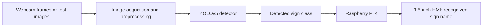

# Traffic Sign Recognition Using YOLOv5 on Raspberry Pi

**Academic minor project · Semester VI · 2023–2024 · KLE Technological University**

> **Repository status — documentation foundation.** This repository currently contains documentation only. The source code, trained weights, dataset, dependency manifest, and reproducible evaluation artifacts have not been added, so the project described below is not yet runnable from this repository.

This project report describes a traffic-sign detection and classification prototype using YOLOv5, Python, PyTorch, OpenCV, and a Raspberry Pi 4. The reported system processes webcam frames or test images and displays recognized sign names on a 3.5-inch Raspberry Pi HMI.

## Project goals

- Detect and classify traffic signs in images and live camera input.
- Explore edge inference on a Raspberry Pi 4.
- Show recognized sign names on a small HMI display.
- Document data, implementation, results, and limitations so the work can be reproduced and evaluated.

The report frames the work as a potential driver-awareness aid for intelligent transportation and ADAS research. It is an academic prototype, not a certified or safety-critical driving system.

## Reported project scope

The following describes the project report, not features verified in this repository:

- Object detection and class recognition for traffic signs, including regulatory, warning, and informational categories.
- Inputs from a Fingers 720p webcam and test images (the report names `cim2.jpg`).
- YOLOv5-based model trained for 100 epochs on a Roboflow road-sign dataset reported to contain 2,100 images and 17 classes.
- Raspberry Pi 4 deployment with a 3.5-inch HMI that displays recognized sign names.
- Testing across daylight, night, rain, snow, and differing sign orientations is described in the report; a reproducible test protocol and results by condition are not included here.

The report does not establish that bounding boxes or confidence scores were shown in the final HMI. Although YOLOv5 can produce these outputs, this README does not claim that they were part of the delivered interface.

## Processing overview



This diagram summarizes the reported design; the corresponding code and hardware integration are not present in the repository yet.

## Dataset

The report identifies the Roboflow Universe dataset [road-signs-6ih4y](https://universe.roboflow.com/roboflow-100/road-signs-6ih4y) and reports 2,100 images across 17 object-detection classes with bounding-box annotations. It describes regulatory, warning, and informational signs.

The report does not provide the exact class-name list, dataset version, split sizes, augmentation configuration, or license terms. Verify these details on the dataset page and in the actual training configuration before reproducing results or redistributing data. Do not commit the dataset to this repository unless its terms explicitly permit it.

## Method and tools

| Component | Reported use |
| --- | --- |
| YOLOv5 | Traffic-sign object detection and classification |
| Python, PyTorch | Model and application development |
| OpenCV | Image/video processing |
| Roboflow | Dataset management and download |
| Raspberry Pi 4, Raspberry Pi OS | Edge-computing target |
| Fingers 720p webcam | Camera input |
| 3.5-inch HMI | Display of recognized sign names |
| VS Code | Development environment named in the report |

The report mentions installing Ultralytics version `8.0.0`, but does not identify the exact YOLOv5 variant, code revision, model-weight filename, or whether the final model was trained from scratch or fine-tuned from pretrained weights. The exact working environment and dependency versions need confirmation from the project source before a requirements file or setup command can be considered reproducible.

## Reported results

These are figures stated in the academic report. They have not been independently reproduced or validated from artifacts in this repository.

| Reported result | Report value | Evidence still needed |
| --- | --- | --- |
| Recognition accuracy | Approximately 95% | Metric definition, evaluation split, sample count, and evaluation output |
| Training duration | 100 epochs | Training command, configuration, logs, and checkpoint provenance |
| Recognition time | Below 100 ms per image | Device used for timing, timing boundaries, warm-up, sample count, and aggregation |
| Classes | 17 | Exact class names and dataset configuration |

The report mentions a confusion matrix and F1 curve and describes tests using randomly sourced Google images. The numerical precision, recall, F1, and mAP values are not specified. Random web images do not constitute a documented held-out benchmark. Avoid treating the reported figures as verified performance claims until the evaluation can be reproduced on a documented split with clear metric definitions.

The report identifies occasional recognition difficulties for U-turn and railway-crossing signs. Other expected challenges include changes in lighting, weather, viewpoint, image quality, occlusion, and sign condition; performance in these cases has not been independently characterized here.

## Hardware and cost

The report lists a Raspberry Pi 4, a Fingers 720p webcam, and a 3.5-inch HMI display, with an approximate total hardware cost of **₹9,900**. It does not specify the Raspberry Pi memory configuration, purchase date, itemized costs, or a reproducible hardware benchmark. Treat the cost and performance figures as report-reported and time-dependent.

## Repository contents

```text
.
├── README.md
├── CONTRIBUTING.md
└── docs/
    ├── IMPLEMENTATION_STATUS.md
    └── PROJECT_PLAN.md
```

This repository currently has no `src/` directory, notebook, model weights, dataset, results directory, or dependency manifest. Those should be added when the actual project files are available and their provenance and usage terms are understood.

## Setup and execution

There is currently no project-specific installation, training, or inference command that can be run from this repository. The academic report describes installing dependencies, downloading the dataset through Roboflow, training for 100 epochs, validating, predicting on `cim2.jpg`, and deploying to Raspberry Pi, but it does not provide a complete reproducible source listing, exact commands, dependency lockfile, or model-weight path.

Do not infer that upstream YOLOv5 commands or dependencies have been tested against this repository. Add verified setup and run instructions after the actual source, configuration, and environment are available.

## Limitations and safety

- No implementation or trained weights are present in this repository.
- The dataset license, exact class list, version, and train/validation/test splits remain to be verified.
- The report notes occasional confusion involving U-turn and railway-crossing signs.
- The reported accuracy and inference time lack enough evaluation detail for independent reproduction.
- Raspberry Pi performance depends on the exact hardware, software stack, model, and measurement procedure.
- The report's tests do not establish reliability across all roads, regions, sign designs, weather, or operating conditions.
- This is an educational/research prototype. It is not safety-certified and must not be relied on for real-world driving decisions or vehicle control.

## Roadmap and status

See [docs/PROJECT_PLAN.md](docs/PROJECT_PLAN.md) for the documentation and implementation roadmap and [docs/IMPLEMENTATION_STATUS.md](docs/IMPLEMENTATION_STATUS.md) for the distinction between report-described work and repository-verified work.

## Contributors and acknowledgements

The report identifies the project contributors as **Vivekanand Naik, Sunil Dyamakkanavar, Chetan Havanagi, and Samarth G.** It names **Dr. Ujwala Patil** and **Prof. Sahana Punagin** as project guides and **KLE Technological University** as the institution.

- Dataset: [Roboflow Universe — road-signs-6ih4y](https://universe.roboflow.com/roboflow-100/road-signs-6ih4y).
- Model family: [Ultralytics YOLOv5](https://github.com/ultralytics/yolov5). The exact code revision and project-specific changes have not yet been recorded.

These acknowledgements reflect the supplied project-report details. Review applicable licenses and attribution requirements before redistributing code, data, model weights, or figures.

## License

No license has been selected for original work in this repository. Dataset, upstream code, dependencies, and model weights may have separate terms; check them before reuse or redistribution.

## Author

**Vivekanand Naik** · [GitHub](https://github.com/vivekanandnaikk) · [LinkedIn](https://www.linkedin.com/in/vivekanand-naik)
